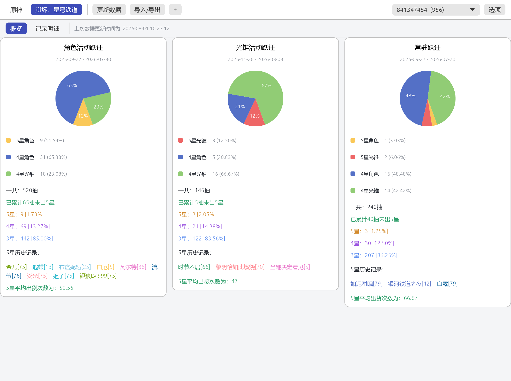
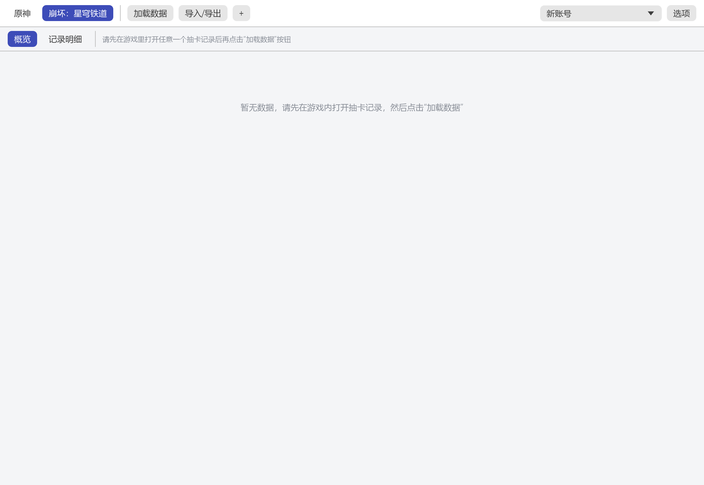
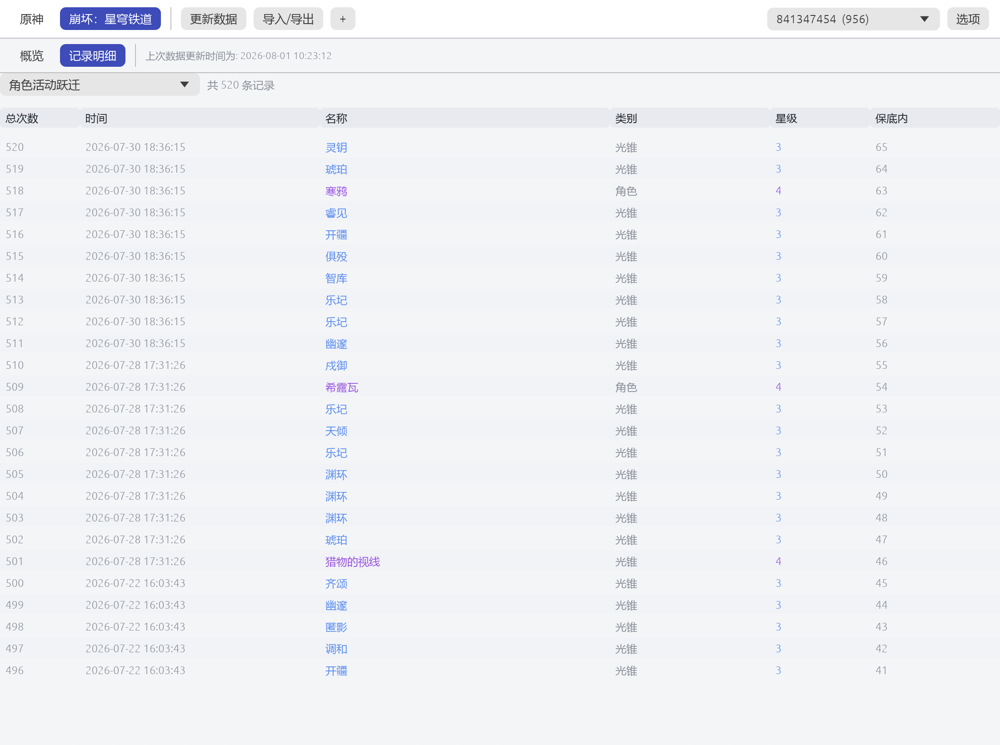
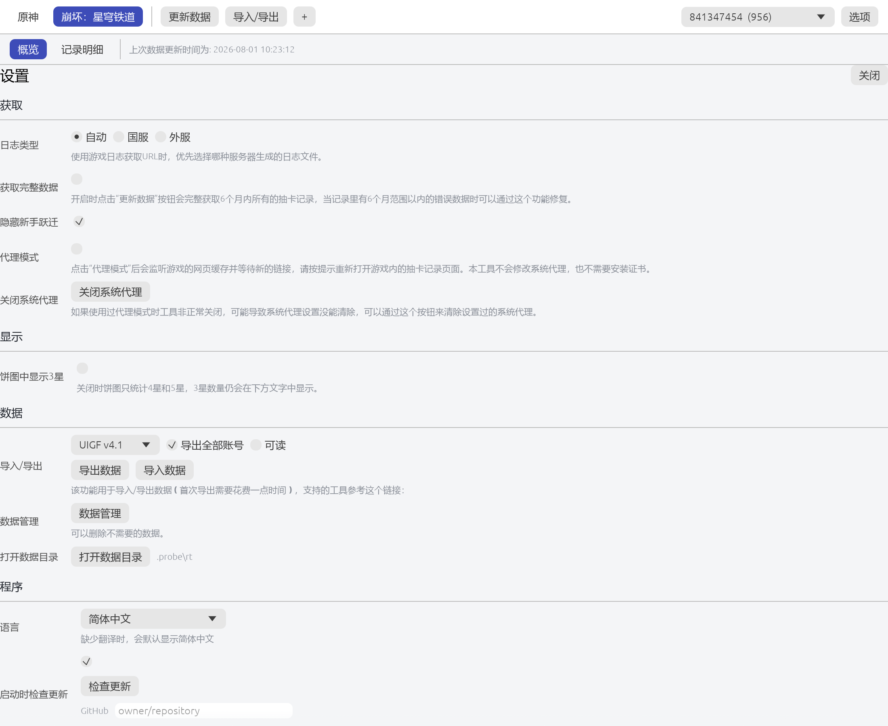

# AuroraExport

**原神祈愿 / 崩坏：星穹铁道跃迁记录获取、统计与导出工具。**

AuroraExport 使用 Rust 和 egui/eframe 构建，将原神与星穹铁道的记录管理整合到一个原生桌面应用中，无需 Electron 或 Node.js 运行环境。支持本地保存、多账号切换、卡池统计，以及 Excel、UIGF 数据导出。

> 本工具不是游戏官方产品。记录获取依赖游戏日志、网页缓存和记录接口；游戏更新、安装路径及运行环境变化可能影响自动获取。请定期备份本地数据，不要公开包含 `authkey` 的记录链接。

## 功能

- **双游戏、多账号**：在原神与星穹铁道之间切换，按游戏和 UID 管理记录。
- **记录获取**：从游戏日志与网页缓存提取记录链接，也可手动输入链接；支持国服、国际服路径识别，以及原神云游戏日志路径。
- **增量更新**：合并新旧记录并去重，可在设置中启用完整历史获取。
- **统计与明细**：按卡池查看抽数、星级分布、五星历史、平均抽数和当前保底计数，并查看逐条记录。
- **Excel 导出**：生成 `.xlsx` 文件，按卡池分表，包含时间、名称、类型、星级、总次数和保底次数等字段。
- **JSON 导入导出**：支持 UIGF v4.1 双游戏导出、原神 UIGF v3.0 导出；可导入 UIGF v4.0/v4.1、原神 UIGF v3.0、星穹铁道 SRGF 和兼容的本地 JSON。
- **本地存储**：优先使用程序旁的 `userData` 目录，支持自定义数据目录与旧版数据迁移。
- **多语言界面**：简体中文、繁体中文、英语、德语、西班牙语、法语、印尼语、日语、韩语、葡萄牙语、俄语、泰语、越南语。
- **命令行工具**：支持无界面获取、自检、链接诊断、权限诊断和界面截图。

## 界面预览

### 统计概览



<details>
<summary>更多截图：原神、记录明细与设置</summary>

#### 原神



#### 记录明细



#### 设置



</details>

## 快速开始

### 启动与获取记录

1. 准备对应平台的可执行文件；如果只有源码，请先参阅下方的「源码构建」。Windows 下运行 `aurora-export.exe`。
2. 将程序放在具有写入权限的目录中，建议以普通用户身份启动。
3. 在工具中选择游戏，然后在游戏内打开祈愿历史或跃迁记录页面，等待页面加载完成。
4. 回到工具更新记录。程序会尝试从日志定位游戏目录，再从网页缓存读取记录链接。
5. 获取完成后，在概览和明细页面查看数据；切换 UID 可查看其他已保存账号。

首次使用时，建议在设置中确认服务器类型。自动识别失败时，可选择国服或国际服，或使用手动链接获取。

**关于“代理模式”**：界面保留了这一名称，但当前实现是监听网页缓存中的新链接，不是 HTTPS 中间人代理，不安装证书，也不自动开启系统代理。使用时先启动获取，再在游戏内重新打开历史页面。该模式仍依赖可读取的游戏缓存；设置中的“关闭代理”用于清理旧工具可能遗留的系统代理设置。

> 只能获取游戏接口当前仍然返回的历史记录，无法恢复已经不再提供、且从未在本地保存的记录。“完整历史获取”也不绕过这一限制。

### 导出与导入

- **Excel**：选择账号后使用导出功能，将记录保存为 `.xlsx`。
- **UIGF**：在设置中选择导出版本，以及是否导出全部账号。UIGF v4.1 可包含两款游戏的数据，v3.0 仅支持原神。
- **导入**：在设置中选择兼容的 JSON 文件，记录会与本地同游戏、同 UID 的数据合并。导入已有账号时程序会尝试备份原文件，但仍建议事先手动备份整个数据目录。

原神 UIGF 导出在需要补全物品 ID 时可能访问 UIGF 物品字典服务，并将字典缓存到本地；星穹铁道使用内置物品字典。

## 数据保存与迁移

数据目录按以下优先级选择：

1. 命令行 `--data-dir <目录>` 指定的位置。
2. **可执行文件所在目录**下的 `userData`，不是终端当前工作目录。
3. 若上述便携目录不可写，回退到系统数据目录下的 `AuroraExport`；若存在旧的 `AuroraWarpExport` 目录且新目录尚不存在，则继续使用旧目录。

典型内容：

```text
userData/
├── config.json                       # 界面、语言、游戏与获取设置
├── gacha-list-<UID>.json              # 账号记录
├── gacha-list-<game>-<UID>.json       # 两款游戏 UID 冲突时使用的文件名
├── item-id-dict.json                  # 按需生成的原神物品 ID 字典缓存
├── log.txt                           # 运行日志
└── backup/
    └── <UID>/                        # 导入已有账号时的备份
```

迁移建议：

1. 关闭新旧工具，并复制一份原始数据作为备份。
2. 将旧工具的 `gacha-list-*.json` 放入新工具的数据目录，或通过界面导入兼容 JSON。
3. 启动后核对游戏、UID、卡池和记录总数，再继续更新。

加载器也接受 `userData/genshin/`、`userData/starrail/` 子目录中的账号文件。跨设备迁移时，建议复制完整数据目录，或导出 UIGF 后导入。

## 命令行

以下示例使用 Windows PowerShell。在 Linux/macOS 上，将可执行文件路径替换为 `./aurora-export`。

```powershell
# 查看帮助与版本
.\aurora-export.exe --help
.\aurora-export.exe --version

# 启动原神界面，使用指定的数据目录
.\aurora-export.exe --game genshin --data-dir .\userData

# 无界面获取：自动从游戏日志与网页缓存读取链接
.\aurora-export.exe --game starrail --data-dir .\userData --fetch auto

# 手动链接获取：仅在本机替换占位符，不要分享真实链接
.\aurora-export.exe --game genshin --data-dir .\userData --fetch "<包含 authkey 的完整记录链接>"

# 诊断自动获取到的链接，输出中的 authkey 会被遮蔽
.\aurora-export.exe --game starrail --probe-url

# 对已有本地数据执行自检，将测试产物写入指定目录
.\aurora-export.exe --data-dir .\userData --selftest .\selftest-output

# 渲染指定页面并保存截图，需要可用的桌面图形环境
.\aurora-export.exe --data-dir .\userData --screenshot .\overview.png --view overview --size 1200x820
```

| 参数 | 用途 |
| --- | --- |
| `--game <GAME>` | `genshin` 或 `starrail`；未指定时使用配置中的游戏，首次默认星穹铁道 |
| `--data-dir <DIR>` | 自定义数据目录 |
| `--fetch <URL\|auto>` | 无界面获取记录，完成后退出；`auto` 避免将真实链接写入命令历史 |
| `--selftest [DIR]` | 运行内置数据检查；省略输出目录时使用系统临时目录下的 `aurora-selftest` |
| `--probe-url` | 检查日志、缓存中的记录链接及解析结果 |
| `--permission-probe <DIR>` | 报告进程权限并通过临时文件测试目录写入 |
| `--console-probe` | 检查控制台与窗口处理 |
| `--screenshot <PNG>` | 保存一帧界面截图后退出 |
| `--view <VIEW>` | 截图页面：`overview`、`detail`、`settings`，与 `--screenshot` 配合使用 |
| `--size <WxH>` | 初始窗口尺寸，例如 `1200x820` |
| `--help` / `-h` | 显示帮助 |
| `--version` / `-V` | 显示版本 |

自检会检查卡池配置和语言文本，并针对数据目录中已有的账号执行本地 JSON 往返、统计、Excel 和 UIGF 导入导出检查。没有账号时，会跳过这些账号级测试；原神相关检查可能需要访问物品字典服务。`--selftest` 建议放在命令末尾，并显式提供输出目录。

## 源码构建

### 环境要求

- Rust 与 Cargo，建议使用能够满足锁定依赖要求的 stable 工具链。
- Windows：构建 MSVC 目标时需要 Visual C++ 链接工具和 Windows SDK。构建 GNU 目标时，还需要可用的 MinGW/WINDRES 工具链。
- Linux/macOS：需要相应平台的本机构建工具；图形界面运行需要桌面环境。Linux 代码启用了 X11 与 Wayland 支持。
- 中文显示依赖系统中的 CJK 字体；程序会尝试加载微软雅黑、苹方、Noto Sans CJK 等预设路径中的字体。

源码包含 Windows、Linux 和 macOS 平台分支，但这不表示各平台均已完成发布验证。自动发现游戏记录主要依赖 Windows 风格日志与缓存路径；其他环境可考虑手动链接或 JSON 导入。Wine 环境下的路径推断支持读取 `WINEPREFIX`。

### 构建与运行

在项目根目录执行：

```powershell
# 开发运行：显式指定数据目录，避免写入 target/debug/userData
cargo run --locked -- --data-dir .\userData

# Release 构建
cargo build --release --locked

# Windows 构建产物
.\target\release\aurora-export.exe --data-dir .\userData
```

Linux/macOS 的默认 Release 产物为 `target/release/aurora-export`。图标、语言表、卡池配置等资源在构建时嵌入程序，无需另外启动前端服务。

项目的 `.cargo/config.toml` 默认将 crates.io 替换为 rsproxy 镜像。若需要使用官方源，可移除或调整该文件中的源替换配置。

### 测试

```powershell
# 单元测试与集成测试
cargo test --locked

# 格式检查
cargo fmt --all -- --check

# 针对已有账号数据的自检
cargo run --locked -- --data-dir .\userData --selftest .\selftest-output
```

### 打包

```powershell
# 使用 Windows PowerShell 构建并打包
powershell -NoProfile -File .\scripts\package.ps1 -Target win

# 已有 Release 产物时跳过构建
powershell -NoProfile -File .\scripts\package.ps1 -Target win -SkipBuild

# 或通过批处理包装脚本执行
.\scripts\package.cmd -Target win
```

输出为 `dist/aurora-export-<version>-<target>.zip`，包含可执行文件、README、LICENSE 和图标。README 中的截图使用仓库相对路径，当前打包脚本不会把 `docs/` 截图复制到压缩包。

`-Target win|linux|macos` 仅用于选择文件名与包名，**不会自动配置交叉编译**。请先在对应环境生成 `target/release/` 中的正确产物，再进行打包。

## 项目结构

```text
src/
├── main.rs              # 程序入口与命令行参数
├── app.rs               # 应用状态和交互逻辑
├── ui/                  # 概览、明细、设置与对话框
├── fetch.rs             # 记录分页获取
├── urltools.rs          # 日志、缓存扫描与链接解析
├── proxy.rs             # 缓存监听式链接获取、旧代理清理
├── model.rs / store.rs  # 数据模型、配置与本地持久化
├── stats.rs             # 卡池统计
├── excel.rs / uigf.rs   # Excel、UIGF 等格式处理
├── jobs.rs              # 后台任务与进度消息
└── selftest.rs          # 内置数据自检
assets/                  # 图标、语言表、物品字典与 JSON Schema
build_support/           # Windows 可执行文件资源生成
scripts/                 # 打包、语言合并、图标和截图辅助脚本
tests/                   # 集成测试
docs/                    # 界面截图
```

## 常见问题

### 找不到记录链接，或链接已过期

重新在游戏内打开历史记录页面，等待加载后再次获取。检查所选游戏、服务器类型及游戏日志是否可读；尝试缓存监听模式、手动链接，或使用 `--probe-url` 诊断。自动扫描不保证覆盖所有自定义安装与兼容层路径。

### 历史记录不完整

先检查是否选择了正确的 UID 和卡池。游戏接口可能不再返回较早记录；这部分数据需要从此前的本地备份或 UIGF/SRGF 文件导入，重新获取无法凭空恢复。

### 保存或导出失败

选择普通用户可写的目录，避免只读目录和受限位置。可使用 `--data-dir` 指定数据目录，或运行 `--permission-probe <目录>` 检查写入权限。若程序从沙箱或受限进程启动，系统文件选择器不会自动解除这些限制，可从资源管理器或普通终端直接启动后重试。

### 中文显示为方框

检查系统是否有程序支持路径中的 CJK 字体，安装后重启应用。Linux 可优先检查 Noto Sans CJK 字体路径。

### 更新检查没有可用源

更新检查需要在设置中配置 GitHub 仓库，格式为 `owner/repo`，默认值为空。当前实现用于检查新版本并打开发布页面，不是自动下载替换程序的自更新器。

## 隐私与安全

- 账号记录与配置保存于本地。正常使用不需要输入游戏账号密码，但记录获取仍需要联网访问游戏记录接口。
- `authkey` 是敏感凭据。不要把完整记录链接粘贴到公开问题、截图、日志或聊天中；命令行直接传入链接也可能留下历史记录，优先使用 `--fetch auto`。
- 本地记录包含 UID、抽卡时间和物品等信息，分享数据前请先检查内容。
- 原神物品 ID 补全可能访问 UIGF 字典服务；配置更新源并执行检查时会访问 GitHub。
- 请保留独立备份，不要将导入时的自动备份视为唯一的数据保护措施。

## 致谢与许可证

本项目整合重写了 `biuuu/genshin-wish-export` 与 `biuuu/star-rail-warp-export` 的相关功能，界面文本、卡池名称表及星穹铁道物品字典沿用了这两个 MIT 项目的资源。相关版权声明保留在 [LICENSE](LICENSE) 中。

AuroraExport 使用 **MIT License**，详见 [LICENSE](LICENSE)。游戏名称及相关素材的权利归各自权利人所有。
